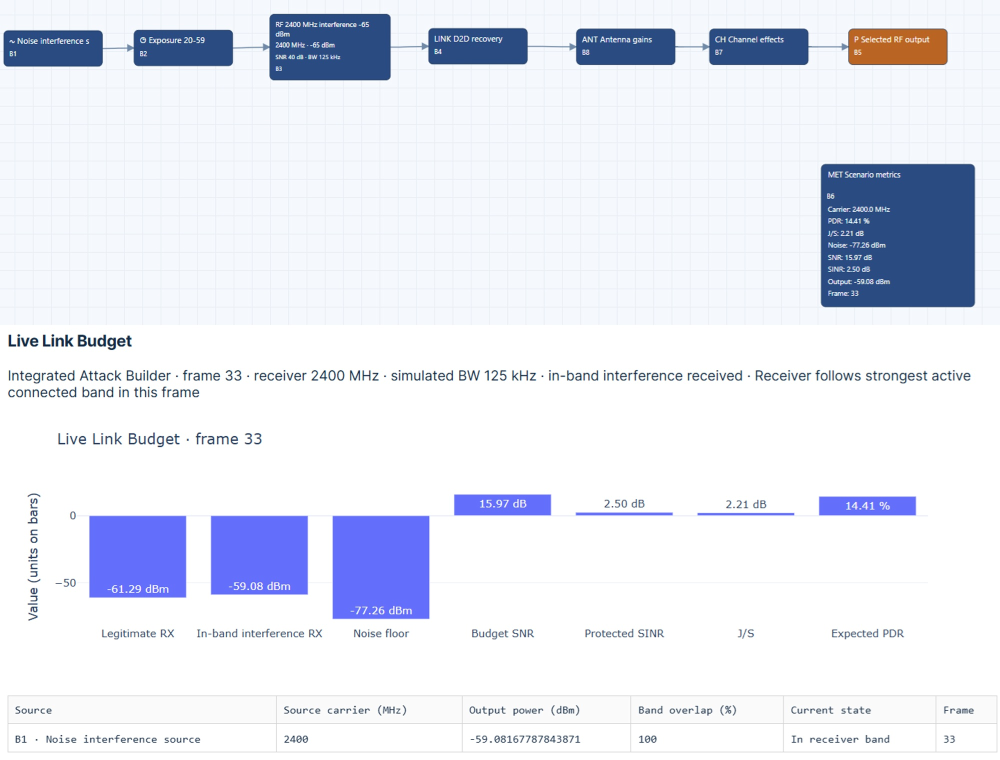

# Cybersecurity of High-Altitude Platform Systems: Anti-Jamming and Resilient Communications
When evaluating HAPS communication security, consider the platform’s power, processing, thermal, payload, and maintenance limits. A typical setup includes communication payloads, processing units, navigation and timing sources, ground interfaces, and health-monitoring functions. Also consider redundancy and reconfiguration options, along with their resource costs and dependencies. Resilience features may require additional signal processing, monitoring, coordination, or switching functions. When assessing these, report processing delays, memory use, energy needs, service continuity, and recovery behavior. Also, check the architecture for shared dependencies that could weaken redundant subsystems.

## Practical Example: Unequal Path Availability and Stable Recovery
Resilient communication requires monitoring, selection logic, transition confirmation, and an explicit resource budget. This exercise uses simplified terrestrial-style workflows to explore these architectural functions. It does not treat their outputs as evidence of high-altitude platform station (HAPS) performance.

### Practical Exercise 14.1: Resilient Communication Architecture and Abstraction Limits
Objective. Compare unequal communication paths, propose a usable-path selection and recovery-confirmation policy, and identify the additional models and measurements required before evaluating a HAPS implementation.
Worked situation. Use `D2D_Asymmetric_Links_2400MHz.json` and `D2D_Recovery_2400MHz.json` as simplified exercises in unequal path availability and post-disturbance restoration. Compare the two evaluated branches in the asymmetric-links workflow, then examine restoration behavior in the recovery workflow. Treat these as complementary observations unless you have developed and verified an explicitly integrated implementation.

The terrestrial-style 2.4 GHz workflows do not represent HAPS propagation, geometry, or payload constraints. Those models require separate development. An anchor-to-target branch is not automatically a substitute for a HAPS feeder, service, or inter-platform link.
Supporting scenarios are provided through the book’s repository:
UAV CyberPhysical Security repository

**Practical procedure**
Preserve both configurations and record simulator versions, waveform and channel settings, timer semantics, and random seeds where supported.
Identify the two evaluated branches and verify branch selection, output routing, measurement reference points, and observation timing.
Compare branch-specific performance using equivalent windows and declared acceptance criteria. Retain missing or stale observations explicitly.
Inspect the recovery scenario and compare performance before, during, and after the modeled disturbance. Verify timer settings rather than relying on display labels alone.
Propose monitoring, selection, switching confirmation, stable recovery, and fallback functions. Identify which functions are absent from the supplied workflows.
Specify resource requirements, shared dependencies, additional instrumentation, and separate HAPS modeling tasks. Report the architecture as conceptual until implementation and verification are complete.
Illustrated path comparison. The path-comparison image below shows the simplified evaluated branches and their observation points.

Proposed configuration view for comparing unequal communication paths in a terrestrial-style 2.4 GHz simulation. Separate branch records support the conceptual selection exercise but do not establish HAPS link performance.
Hint. Two logical branches may share one receiver, power source, clock, antenna, gateway, or propagation obstruction. Such branches are not necessarily independent redundant paths. Likewise, selecting a displayed branch does not prove that communication traffic was switched or that the destination remained reachable.
Worked solution: conceptual architecture. Define five explicit functions:

* **Monitoring:** collect timestamped path-quality observations and validity indicators at defined reference points.
* **Eligibility assessment:** determine whether each candidate satisfies the mission’s service requirement over a stated observation window.
* **Selection and coordination:** choose an eligible candidate and coordinate the required endpoint or route change.
*  **Confirmation and recovery:** verify delivery after a transition and require sustained acceptable service before declaring stable recovery.
* **Fallback and oversight:** handle no-usable-path conditions, failed transitions, and unresolved measurements under an assigned operator or approved control policy. Map each function to a proposed software component, hardware interface, evidence output, and responsible owner. Preserve the original workflows as exposure inputs. If additional candidate channels, traffic forwarding, acknowledgment handling, or controller state logic are required, identify and version those additions separately.

**Worked solution:** proposed selection policy. Define path eligibility using a justified performance threshold, valid-data coverage, and observation-age limit. When using expected PDR, label the result as model-based. Do not infer latency or throughput from PDR alone.
Retain the current path as long as it remains acceptable unless an alternative offers a predefined sustained advantage. Specify a switching margin, persistence interval, and minimum dwell time where appropriate. Define how a failed current path changes the decision and how stale candidate data are treated. These rules are proposed additions, not functions established by the JSON filenames.
After a switch request, require explicit confirmation that the selected path carries valid traffic. If confirmation fails, record the failed transition and use the documented fallback. When no path satisfies the criteria, report degraded or unavailable service rather than silently selecting the least-poor path as acceptable.

**Worked solution:** stable recovery. Define recovery as the sustained satisfaction of the required service criteria for a declared interval, supported by fresh observations. Record disturbance cessation, the first acceptable observation, transition confirmation (if applicable), and recovery acceptance as separate events. Evaluate recurrence and oscillation near thresholds, and document whether returning to a preferred path is necessary or merely optional.
An exposure-free interval does not prove recovery. If the criterion is not satisfied before the observation ends, report recovery as not demonstrated. In a conceptual exercise without an implemented controller, present a proposed timeline and verification plan rather than claiming measured switching or restoration.
Illustrated recovery and architecture. The recovery image below shows the recovery observations and the proposed monitoring/selection boundary.

Proposed recovery-assessment view and conceptual resilient-communication architecture. Stable-recovery acceptance requires sustained service evidence; actual switching and HAPS-specific behavior require additional implementation and validation.
Shared dependencies and resource requirements. Inventory shared RF front ends, antennas, timing sources, computing resources, gateways, backhaul, power supplies, and environmental exposures. State which faults could affect both candidates and avoid assuming statistical independence without evidence.
Budget monitoring and probing traffic, controller execution, buffering, coordination messages, retuning or route-change time, and any simultaneous-receiver requirement. Identify additional RF chains, antenna interfaces, processing capacity, memory, and electrical power the proposed architecture needs. Record which requirements are modeled, estimated, or measured.
Additional HAPS modeling and measurement. Develop mission-specific geometry, altitude and slant-range relationships, elevation-dependent propagation assumptions, antenna patterns and pointing, mobility and timing effects, and channel conditions appropriate to the intended operating environment and frequency. Explicitly identify the link roles and network topology. Separately define payload mass, electrical power, thermal, computation, and interface constraints for the selected platform; none is supplied by the terrestrial-style scenarios.
Measure RF power at calibrated reference planes and distinguish it from electrical power consumption and energy demand. Measure observation age, processing latency, coordination delay, service interruption, and recovery time on the implemented architecture. Obtain propagation evidence appropriate to the intended geometry and environment, or report the uncertainty of an unvalidated model. Do not extrapolate the 2.4 GHz scenario results directly to an operational HAPS link budget or mission endurance.
Implementation checklist:

- [ ] State abstraction limits and distinguish terrestrial-style inputs from HAPS models.
- [ ] Identify shared dependencies and possible common-cause failures.
- [ ] Verify branch selection and compare equivalent observation windows.
- [ ] Define eligibility, switching, confirmation, and stable-recovery conditions.
- [ ] Specify fallback behavior and operator responsibilities.
- [ ] Identify additional RF hardware, computation, memory, and power resources.
- [ ] Specify additional power, latency, and propagation measurements.
- [ ] Separate conceptual design, implemented behavior, and verified results.

**Expected deliverable:** A conceptual resilient-communication architecture with explicit monitoring, switching, recovery, and resource requirements, supported by separate branch observations and a verification plan. Include the shared-dependency assessment and any additional HAPS-specific models and measurements needed before making performance claims.
**Practical Exercises:** HAPS Relay Availability, Trust, and Mission Resilience
The named equations refer to the full chapter; the supplied numerical calculations are reproduced below.
These exercises apply the relay-system, SINR, availability, path-diversity, trust, and mission-risk equations to a HAPS-assisted UAV mission. Students must distinguish a functioning radio connection from timely, authenticated, and operationally acceptable C2 service.

### Practical Exercise 14.2: HAPS Relay Link Quality and Operational Availability
**Objective:** Evaluate an impaired UAV-to-HAPS link, reconstruct unavailable-service intervals, and determine when an additional relay path improves mission continuity.

**Worked situation:** A UAV performs a 600 s emergency-observation mission. Its communication system includes a direct ground path, a HAPS relay, and an alternative mesh path. Use the relay-system model to identify the UAV-to-HAPS segment, ground backhaul, any satellite/core-network forwarding segment, and C2, telemetry, and payload traffic. Specify whether satellite/core forwarding is actually required for the chosen end-to-end route rather than assuming all segments are always in series. At the HAPS receiver, the desired received signal is $-80$ dBm, the received interference from the modeled disturbance is $-85$ dBm, the other aggregate interference is $-95$ dBm, and the integrated noise is $-100$ dBm. All powers refer to the same receiver input and observation bandwidth, with propagation and antenna effects already included.
**Tasks:** Compute SINR using the receiver SINR equation; compare it with a declared 6 dB decoding criterion.
Reconstruct complete-loss, stale-information, and unsafe-command intervals and calculate operational availability using the operational-availability equation, correcting for overlapping intervals. Calculate the independent-path estimate in the path-diversity equation and evaluate a shared-dependency example. Specify the evidence and measurements needed to verify a HAPS relay implementation and a coordinated path transition.

**Worked solution link quality:** Convert powers to a common linear unit before summing the denominator:

$$
\mathrm{SINR}{u,h}
=\frac{10^{-80/10}}
{10^{-100/10}+10^{-85/10}+10^{-95/10}}
\approx2.79,
\qquad \mathrm{SINR}{dB}\approx4.46,\mathrm{dB}.
$$

The result violates the illustrative 6 dB criterion. Received powers already incorporate the $P G$ terms in the receiver SINR equation; do not multiply by antenna gains or path losses again. This calculation does not establish packet loss, latency, or hostile intent without a receiver model and additional evidence.

**Worked solution operational availability:** Suppose verified service records identify the following half-open intervals in seconds:
* Condition	Interval	Duration
* Complete loss	$[100,130)$	30 s
* Stale information	$[120,160)$	40 s
* Unsafe command service	$[150,170)$	20 s
* Adding these durations directly would double-count overlapping service failures. Apply the operational-availability equation using mutually exclusive state accounting, or replace its numerator with the duration of the union of the three event sets. Here their union is $[100,170)$, with duration 70 s:
  
$$
A_{HU}=1-\frac{70}{600}=0.8833.
$$

A disjoint decomposition is 30 s loss, 30 s additional staleness, and 10 s additional unsafe service. State the priority rule used to assign overlapping conditions. Raw radio uptime alone would give $1-30/600=0.95$, obscuring periods of connected but unacceptable service.
Define command-freshness limits, required acknowledgments, and the evidence establishing unsafe service before scoring. Record uncertainty or missing telemetry separately; missing observations must not silently count as available time. HAPS C2 availability must cover the required end-to-end service, including backhaul and application validation, not just the air link.
Worked solution: path diversity. For a separate hypothetical model with common mission/service definitions, let path availabilities be $A_1=0.85$, $A_2=0.90$, and $A_3=0.70$. Under independence, the path-diversity equation gives

$$
R_{comm}=1-(1-0.85)(1-0.90)(1-0.70)=0.9955.
$$

This is a model estimate, not a result derived from the preceding 600 s event log. The product expression requires independence; “partially independent” paths require joint probabilities or a dependency model.
For example, suppose all three paths depend on a common gateway available with probability 0.90, and the preceding values describe conditionally independent path availability given that gateway is operating. Then

$$
R_{comm,shared}=0.90(0.9955)=0.89595.
$$

Do not multiply by an additional gateway factor if gateway failures were already included in the marginal values. If simultaneous path-state logs are available, estimate the observed union directly. Account separately for selection delays and command deadlines: an available candidate path does not ensure uninterrupted timely delivery during switching.
Verification checklist:
- [ ] Define the required relay segments and end-to-end C2 service.
- [ ] Record geometry, slant range, antenna/pointing assumptions, receiver bandwidth, and calibrated power reference points.
- [ ] Separate RF quality, packet delivery, freshness, and application acceptance.
- [ ] Avoid double counting overlapping unavailable-service intervals.
- [ ] Identify common gateways, clocks, power sources, and other shared dependencies.
- [ ] Measure transition interruption, latency, payload overhead, and platform power/resource costs.

**Expected deliverable:** A segment-level relay diagram description, worked SINR calculation, auditable availability timeline, qualified diversity estimate, and a validation plan identifying HAPS-specific propagation and implementation evidence still required.

### Practical Exercise 14.3: Relay Trust, Traffic Prioritization, and Mission-Risk Review
**Objective:** Evaluate whether a HAPS path is trustworthy for its intended traffic, prevent composite-score masking of critical failures, and prioritize evidence-backed corrective actions based on mission dependency.

**Worked situation:** A relay remains connected but delivers intermittent stale telemetry while carrying C2 and payload data. The operator must decide whether to retain the HAPS route, switch to an eligible alternate, reduce payload service, or escalate to the predefined degraded-operation procedure. Use separately verified observations of quality, freshness, authentication, routing, and payload integrity.
Tasks:
- Compute the relay-trust score from the relay-trust equation using the supplied normalized values.
- Define mandatory authentication and freshness gates independently of the weighted score.
- Calculate the illustrative mission-risk index using the mission-risk equation and rank corrective-action priorities.
- Propose a traffic-prioritization and recovery procedure with verification evidence and accountable approval roles.

**Worked solution trust calculation:** Choose nonnegative weights $(\alpha,\beta,\gamma,\delta,\eta)=(0.25,0.25,0.25,0.15,0.10)$, summing to one. Let

$$
(Q_{link},Q_{fresh},Q_{auth},Q_{route},Q_{payload})
=(0.90,0.40,1.00,0.80,0.95).
$$

The relay-trust equation yields

$$
\tau_{HU}=0.225+0.10+0.25+0.12+0.095=0.79.
$$

The classroom score threshold of 0.75 is exceeded. However, a separately declared C2 freshness requirement $Q_{fresh}\geq0.80$ fails. The relay is therefore not eligible for the stated C2 service, even though the weighted index passes. Define how the normalized freshness score is obtained from actual command age and deadlines rather than treating an arbitrary score as a physical measurement.
Similarly, with all other terms equal to one and $Q_{auth}=0$, the same weights give $\tau_{HU}=0.75$. A threshold alone could accept failed authentication. Require successful authentication and authorization as mandatory gates where the service policy demands them; use the score only among eligible candidates. The trust index is not a calibrated probability that a relay is uncompromised.
Use traffic-specific interpretation. A payload-integrity score cannot compensate for stale C2, and a C2-critical failure need not imply identical requirements for delay-tolerant payload delivery. Missing evidence is not a perfect quality score. Document score ranges, provenance, validity intervals, uncertainty, and treatment of unavailable components.
Worked solution: mission-risk index. For a synthetic assessment, use three events with normalized inputs:
Event	$w_i$	$L_i$	$I_i$	$D_i$
Air-link disruption	0.40	0.30	0.80	0.90
Stale C2 through relay	0.35	0.20	0.90	1.00
Payload-integrity failure	0.25	0.15	0.60	0.50
The mission-risk equation gives

$$
R_{mission}=0.0864+0.0630+0.01125=0.16065.
$$

Air-link disruption contributes the most, followed by stale C2. An essential freshness violation can nevertheless require immediate action regardless of ranking. Explain the sources of likelihood and impact estimates and assess uncertainty; the weighted sum is a prioritization index, not a probability of mission failure. Correlated events and cascading dependencies require additional analysis before interpreting the sum as aggregate risk.

**Worked solution layered response and recovery**

**Observe and preserve:** Retain timestamps, sequence identifiers, source/session identity, receiver decisions, relay-route records, and observations from the air link and required backhaul. Verify clock alignment before calculating freshness.
Apply eligibility gates. Reject expired or unauthorized commands at the documented receiver interface. Validate alternate-route service, authentication, freshness, and capacity before selecting it.

**Prioritize traffic:** Preserve timely trusted C2 and bounded telemetry ahead of payload traffic. Buffer non-real-time payload only under a defined storage, expiry, and integrity policy; do not deliver obsolete control commands after reconnection.
Coordinate and confirm. Request an approved path transition and record acknowledgment plus observed service on the new route. A selection decision alone is not evidence of executed failover.

**Handle no eligible path:** Invoke the approved degraded-operation procedure and notify the responsible operator. Any claimed hover, landing, or return behavior requires a controller model or telemetry, not just a link-state label.

**Accept recovery:** Require sustained valid, timely, authenticated service and the applicable mission checks. Record the acceptance authority, evidence, interval, and remaining limitations before resuming normal service.

The HAPS relay is a potential shared dependency for multiple UAVs. Include a multi-client disruption case and evaluate whether backup paths still depend on the same relay, gateway, authentication service, or timing reference. Terrestrial 2.4 GHz teaching workflows may illustrate selection logic but cannot validate HAPS propagation, platform endurance, payload constraints, or backhaul capacity without separate models and measurements.
Verification checklist:

- [ ] Justify trust weights, quality definitions, and traffic-specific thresholds.
- [ ] Apply mandatory freshness, authentication, and authorization gates.
- [ ] Separate prioritization indices from probabilities or certification claims.
- [ ] Preserve route, command, payload, and timing evidence with provenance.
- [ ] Test common-cause and multi-UAV dependency failures.
- [ ] Assign response, recovery acceptance, evidence custody, and corrective-action responsibilities.

**Expected deliverable:** A relay-trust calculation with mandatory eligibility gates, an auditable mission-risk assessment, and a prioritized C2/telemetry/payload response procedure supported by recovery evidence and explicit HAPS-model limitations.
