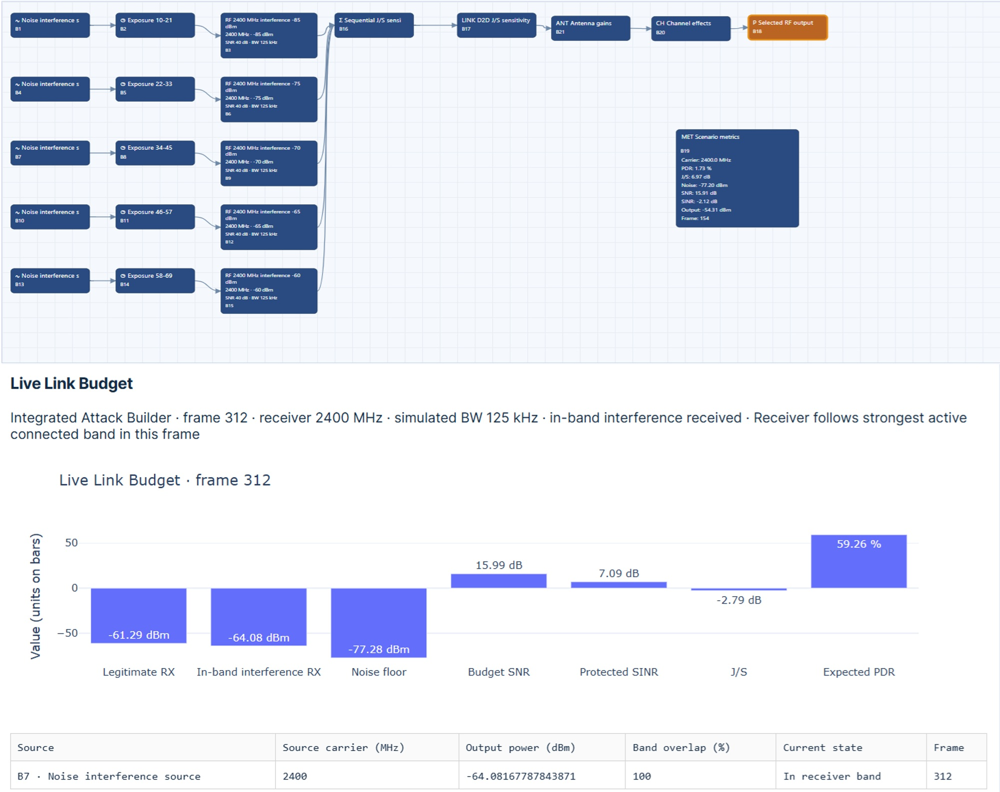
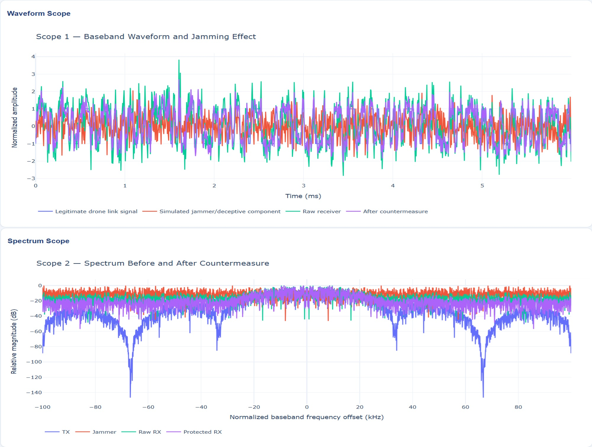

# Threat Modeling and Security Assessment Methodologies for UAS
A security assessment should link mission goals and possible threats to technical requirements, controls, verification steps, and supporting evidence. This clear connection helps reviewers see why each control was chosen, what risk it manages, and if it works as intended in real situations. When using standards in an assessment, first define how each standard applies to your situation before linking it to assessment tasks. For each one, note the requirement, how it fits the UAS context, who is responsible, and what evidence supports implementation. Simply mentioning a standard does not prove compliance.

## Practical Example: Traceable Assessment of Communication Availability
This exercise uses AeroResilience to connect a modeled communication threat to an availability requirement, a reproducible test configuration, reported simulation performance, and a documented acceptance decision. Define acceptance criteria before execution so conclusions remain traceable to stated requirements.

### Practical Exercise 3.1: Communication Availability and Traceable Acceptance Decisions
**Objective:** Develop an evidence-based assessment of communication availability across five sequential interference-reference levels and document the basis for accepting, rejecting, or deferring each result.

**Worked situation:** Load `D2D_JSR_Sensitivity_2400MHz.json`. The supplied scenario description specifies five sequential interference-reference levels and a link-evaluation block configured with a desired received signal of $-70,\mathrm{dBm}$ and a noise-floor setting of $-100,\mathrm{dBm}$. Inspect the loaded configuration to confirm these settings, the five reference levels, their reference points, and their exposure intervals.
Supporting scenarios are provided through the book’s repository:
https://github.com/1Px-Vision/UAV-CyberPhysical-Security

**Acceptance criteria:** define before execution. State the communication-availability requirement, observation interval, minimum acceptable performance, and decision rule before running the scenario. For example, a requirement may specify that reported expected PDR must remain at or above a justified threshold $P_{\min}$ during each evaluated interval. Define whether the criterion applies to every frame, an interval mean, or another explicitly stated statistic. If you evaluate recovery, also define the allowable recovery interval and the condition that constitutes recovery. Select thresholds from the mission’s communication needs and justify them. Do not present an instructional threshold as a universal requirement or a standard-mandated value. Expected PDR is a model-based indicator and does not by itself establish measured operational availability.

**Practical procedure**
Preserve the original JSON file and record the software revision, model assumptions, and random seed where applicable.
Record the desired received signal, noise-floor setting, five interference-reference levels, exposure durations, and relevant RF reference points. Assign interval identifiers $E_1$ through $E_5$ and document the acceptance criteria before execution.
Run the scenario and associate each exposure interval with synchronized simulator outputs, including expected PDR, SNR, SINR, and $J/S$ where reported. Apply the predefined decision rule and record the result as accepted, rejected, or inconclusive. Retain the evidence supporting the decision.
Complete an assessment matrix connecting the threat, requirement, test configuration, result, responsible reviewer, and residual risk.
Illustrated configuration. The configuration image below provides the configuration view for tracing the five exposure intervals to the link-evaluation settings.

AeroResilience configuration view for the communication-availability assessment. The five sequential interference-reference levels and link-evaluation settings provide the configuration evidence used to identify and compare exposure intervals.
Hint. Verify whether an interference-reference level denotes received interference power, a source setting, or a model reference requiring further transformations. Calculate $J/S$ directly from power values only when they refer to the same receiver reference point and compatible bandwidth definitions. Do not infer received interference power from a source setting alone.
Worked solution. Create five assessment records, one for each interval $E_i$, with $i=1,\ldots,5$. Associate every record with the same availability requirement and its predeclared decision rule, while preserving the interval-specific interference configuration and reported performance.
If the desired received signal and noise-floor setting represent compatible powers at the same receiver reference point, their configured difference gives a nominal baseline SNR:

$$
\mathrm{SNR}_{\mathrm{nominal}}
= -70 - (-100) = 30,\mathrm{dB}.
$$

This value describes the stated configuration before any additional model effects; it must not replace the simulator’s reported SNR unless you check the model definitions. Similarly, where $J_{\mathrm{RX},i}$ is the received interference power in dBm at the same reference point as the desired signal. Compare each interval’s reported performance with the predefined acceptance criterion. A result is inconclusive when the required output, timing alignment, or configuration evidence is missing. Do not substitute assumed values for missing observations. If performance is rejected, document the requirement violation and the proposed corrective action; if accepted, document the remaining limitations and residual risk.
The output image below provides the output view used to associate reported performance with exposure intervals.

AeroResilience output view supporting comparison of reported link performance with predefined acceptance criteria. Each result includes an exposure interval, its test configuration, and retained simulation evidence.
Assessment matrix. Use one row per exposure interval in the final assessment matrix. Include the following fields; the table below defines the required fields.
Matrix field	Required entry for each interval $E_i$
Threat	Modeled interference exposure and affected communication function.
Requirement	Requirement identifier, justified threshold, observation statistic, and decision rule.
Test configuration	JSON revision, interval, reference level, signal/noise settings, and RF reference points.
Result	Reported performance, evidence reference, and accepted/rejected/inconclusive decision.
Responsible reviewer	Named reviewer or assigned role, review date, and decision rationale.
Residual risk	Remaining uncertainty, model limitations, operational implications, and corrective-action owner.
Standards and accountability. Identify potentially applicable standards in a separate mapping that records the document identifier, edition, relevant provision, and rationale for applicability. Distinguish mission requirements from standard-derived requirements. The simulation assessment alone does not demonstrate certification or compliance. Record who defined the criteria, performed the evaluation, reviewed the evidence, and authorized the acceptance decision.
Implementation checklist:
* Document model assumptions, RF reference points, and observation intervals.
* Define and justify acceptance thresholds before execution.
* Associate all five exposure intervals with synchronized reported outputs.
* Separate configured values, calculated indicators, and experimental measurements.
* Identify applicable standards separately and document their relevance.
* Retain the configuration, results, and evidence supporting each decision.
* Assign a responsible reviewer and document residual risk and corrective-action ownership.

**Expected deliverable:** A five-row assessment matrix linking the modeled threat, availability requirement, test configuration, reported result, responsible reviewer, and residual risk, accompanied by the supporting configuration and output evidence.
**Practical Example:** Integrating STRIDE, DREAD, and MITRE ATT&CK
A structured UAV security assessment can combine threat identification, explicit prioritization, and evidence-based descriptions of adversary behavior. This exercise uses STRIDE to identify threats at trust boundaries, a declared DREAD rubric to prioritize review, and MITRE ATT&CK to describe supported behavior. The three outputs serve different purposes and must remain traceable to their assumptions and evidence.

### Practical Exercise 3.2: UAV Threat Identification, Prioritization, and Behavior Mapping
**Objective:** Produce a threat register connecting assets and trust boundaries to STRIDE categories, justified DREAD scores, candidate ATT&CK mappings, defensive requirements, verification evidence, and accountable owners.

**Worked situation:** A teaching UAS architecture contains a ground-control station, Wi-Fi C2 interface, companion computer, flight controller, payload-data store, firmware-update process, and supplier-provided software packages. Students receive an architecture description and synthetic evidence records containing: an unauthorized command attempt, exposed test telemetry, a supplier-package discrepancy, an administrative session using a legitimate test account, and an unexplained service outage.
These are exercise observations, not proof of one coordinated attack. Define which records are verified, simulated, or hypothetical. Conduct any validation using an isolated emulator or approved test system and preserve original records.

**Practical procedure**
* Identify assets, data flows, external entities, stores, privileged processes, and trust boundaries. State mission assumptions and the assessment scope.
* Apply all six STRIDE categories to relevant components and boundary-crossing flows. Write each threat as a concrete event with prerequisites, affected asset, and consequence.
* Score selected threats using the declared DREAD rubric. Preserve all five component scores, supporting rationale, uncertainty, and reviewer identities.
* Consult the chosen MITRE ATT&CK domain and release. Map behaviors only where the observed or hypothesized mechanism supports the technique definition.
* Specify controls, measurable acceptance criteria, evidence sources, and responsible owners. Validate in a controlled environment where supported.
* Review residual threats, scoring disagreements, unsupported mappings, and gaps requiring additional observations.

**Worked solution STRIDE register:** Create at least one scoped example for each category:
* **Spoofing:** a client claims an authorized controller identity without adequate verification at the C2 application boundary.

* **Tampering:** a mission configuration or update artifact is modified without an authorized, verified change record.

* **Repudiation:** missing or unreliable audit records prevent attribution of a configuration change to an accountable session.
  
* **Information disclosure:** payload or telemetry content is exposed to an unauthorized observer at a defined interface.
  
* **Denial of service:** essential processing or communication becomes unavailable under a specified adversarial mechanism; an unexplained outage remains a symptom until you establish its cause.
  
* **Elevation of privilege:** a low-privilege companion-computer process obtains permissions outside its assigned role.
  
A threat can involve multiple categories. Do not force a one-to-one correspondence between STRIDE categories and ATT&CK techniques. Record threats that are not supported by the supplied evidence as hypotheses requiring validation.
Worked solution: DREAD prioritization. Use the following locally defined teaching scale from 1 to 5. It is not a universal scoring standard or a calibrated probability model. Intermediate values require a written justification.

**Damage potential ($D$):** 1 denotes limited reversible service impact; 5 denotes severe impact on an essential mission or safety function under the stated scenario.

**Reproducibility ($R$):** 1 denotes an unreliable outcome under rare prerequisites; 5 denotes a repeatable outcome whenever the documented prerequisites hold.

**Exploitability ($E$):** 1 denotes substantial access, expertise, and resources; 5 denotes low effort once the stated prerequisites are present.

**Affected users/assets ($A$):** 1 denotes a localized nonessential asset; 5 denotes broad exposure of essential mission assets or affected users. Document this adaptation of the affected-users dimension.

**Discoverability ($D_s$):** 1 denotes difficult discovery requiring specialized investigation; 5 denotes readily discoverable exposure. Discovery difficulty is not itself a control.
For this exercise, define the arithmetic prioritization score

$$
R_{\mathrm{DREAD}}=\frac{D+R+E+A+D_s}{5}.
$$

Keep this ordinal-score average as a review aid; it does not quantify expected monetary loss, attack likelihood, or operational safety. Mission-critical findings may require immediate review regardless of the average.
For a hypothetical C2 command-authorization weakness, assign illustrative values $(5,4,3,4,3)$ only after stating the assumed access, receiver behavior, and mission consequence. The score is $19/5=3.8$. For a hypothetical telemetry-disclosure issue, values $(3,4,3,2,4)$ produce $16/5=3.2$. These are instructional judgments, not measured findings. Changing one dimension by one point changes the mean by 0.2; assess whether uncertainty or assessor disagreement can change the ranking.

**Worked solution:** MITRE ATT&CK mapping. Record the ATT&CK domain, release or retrieval date, technique identifier, official name, supporting behavior, confidence, and evidence reference. The following Enterprise techniques are candidate mappings, conditional on the mechanism actually established:

**T1040 – Network Sniffing:** consider when evidence establishes passive network-traffic observation or capture. Exposed telemetry alone does not prove an adversary performed sniffing.

**T1557 – Adversary-in-the-Middle:** consider when evidence supports positioning between communicating parties. An arbitrary unauthorized command or replay event does not alone establish such positioning.

**T1195 – Supply Chain Compromise:** consider when products or delivery mechanisms were manipulated before the final consumer received them. A package discrepancy alone is insufficient to prove the mechanism. Use a sub-technique only when evidence supports its more specific scope.

**T1078 – Valid Accounts:** consider when an adversary abuses legitimate account credentials. A legitimate administrative login, without evidence of misuse, is not sufficient.
Do not force an RF outage into a network-flooding technique merely because both affect availability. Record “no justified mapping established” where appropriate. Enterprise ATT&CK is not a complete taxonomy of aviation-specific RF or physical threats; assess scope before choosing another domain and preserve the exact identifiers used. A technique mapping does not identify an actor or prove malicious intent.
Integrated assessment record. For each threat, retain the following linked fields:

- Threat identifier, asset, boundary, prerequisites, and STRIDE category or categories.
- DREAD component scores, rubric version, rationale, uncertainty, and prioritization decision.
- ATT&CK domain/release, candidate technique, evidence, confidence, and unsupported alternatives.
- Defensive requirement, implementation owner, verification method, and predefined acceptance criterion.
- Observed result, evidence identifier, reviewer, residual risk, and corrective-action status.
For the hypothetical C2 weakness, a defensive requirement may specify that the system rejects unauthorized, stale, and duplicate commands according to documented session and freshness rules. Verify legitimate-command acceptance and rejection behavior. Preserve receiver decisions separately from emulator state changes; a received packet is not proof of executed control. Do not claim the requirement has passed until you test the relevant implementation.
Review and limitations. Use at least two assessors to review the scoring rationale and record disagreements rather than hiding them through averaging alone. Separate the design hypothesis, synthetic demonstration, real observation, and verified conclusion. Reassess residual threats using new evidence after controls are tested; do not lower scores solely because a control is proposed. This combined exercise supports engineering review, not automatic certification or proof of complete threat coverage.

Implementation checklist:
- [ ] Define assets, data flows, and trust boundaries before scoring.
- [ ] Apply all STRIDE categories and state concrete threat prerequisites.
- [ ] Declare the DREAD scale and retain component-level rationale and uncertainty.
- [ ] Verify ATT&CK identifiers against an identified domain and release.
- [ ] Distinguish observed behaviors from candidate mappings and unsupported attribution.
- [ ] Connect each priority finding to a requirement, owner, test, and evidence record.
- [ ] Review residual risk and retain assessment disagreements and unresolved gaps.

**Expected deliverable:** An integrated UAV threat register containing STRIDE classifications, justified DREAD prioritization, evidence-supported ATT&CK mappings, defensive requirements, verification plans, and accountable review decisions.
Source references. Consult the applicable versions and record the access date:

* Microsoft, Secure by Design (STRIDE): https://www.microsoft.com/en-us/securityengineering/sdl/practices/secure-by-design.
* Microsoft, Threat Modeling for Drivers (DREAD discussion): https://learn.microsoft.com/en-us/windows-hardware/drivers/driversecurity/threat-modeling-for-drivers.
* MITRE ATT&CK technique definitions: https://attack.mitre.org/techniques/T1040/, https://attack.mitre.org/techniques/T1557/, https://attack.mitre.org/techniques/T1195/, and https://attack.mitre.org/techniques/T1078/.
