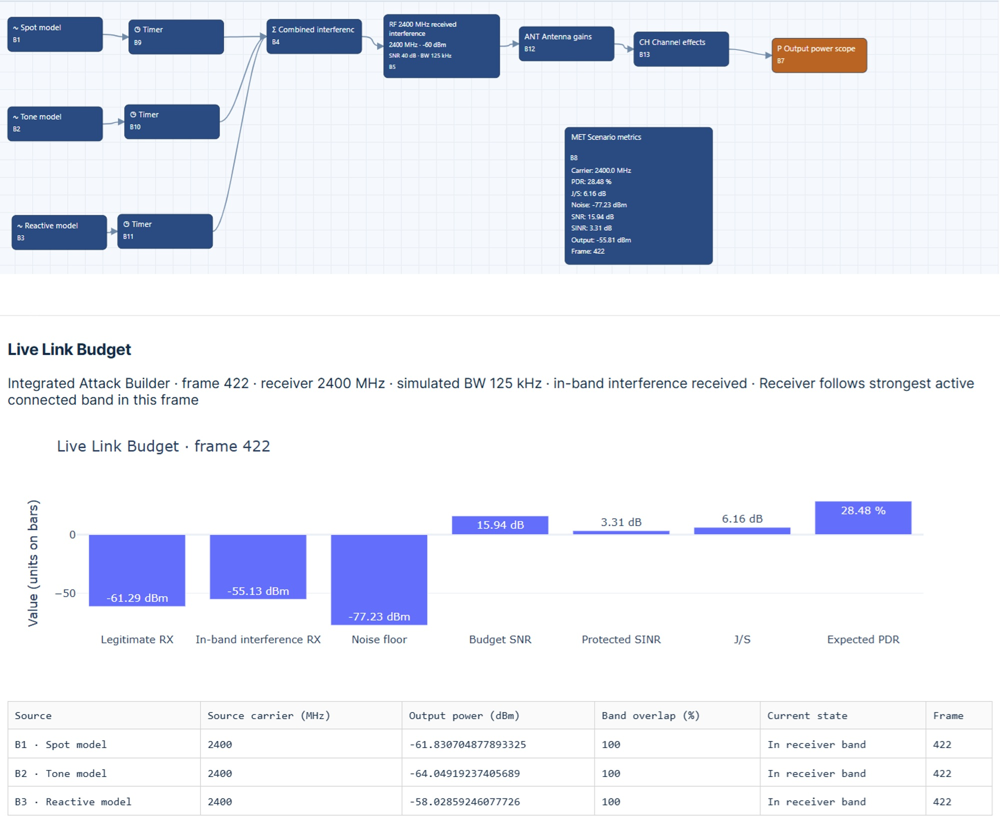
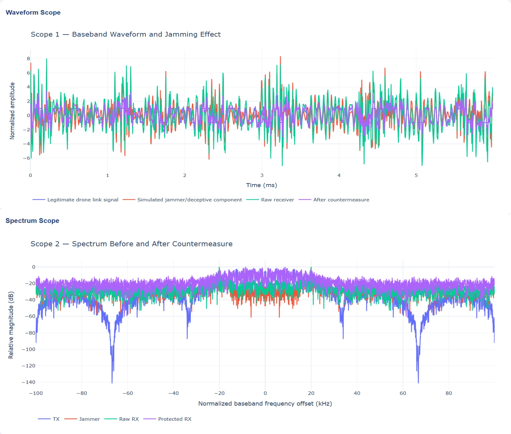

# Deep Learning and Agentic AI for UAV Cyber–Physical Security: Attacks, Detection, and Autonomous Countermeasures
When evaluating AI-based security methods, consider both how well they predict and how practical they are to deploy. Training and inference have different computational needs, so report them separately. Key factors include model size, operation count, peak memory, numerical precision, inference latency, and energy use on the target hardware. Embedded deployment might use a microcontroller, companion computer, GPU, or FPGA accelerator. Choose the platform based on timing needs, power limits, update needs, and integration effort. Agentic systems also need clear action permissions, escalation rules, and records of what was observed, decided, and done. ISO/IEC 42001 offers a framework for managing AI at the organizational level, but that differs from technically validating a single detector.

## Practical Example: AI-Based Monitoring and Decision Evaluation
AI-based monitoring requires reproducible observations, independently established reference labels, and evaluation on data excluded from model development. This exercise uses contrasting AeroResilience scenarios as input sources for a separately implemented classifier or decision policy. It distinguishes simulated interference generation from learned monitoring and defensive control.

### Practical Exercise 7.1: AI Monitoring Performance and Human Approval Boundaries
Objective. Compare the predictive performance, inference latency, memory consumption, and intervention decisions for an independently implemented monitoring model using contrasting simulated interference conditions.
Worked situation. Use `Activity_Dependent_Interference_2400MHz.json`. According to the supplied exercise description, the first combines spot, tone, and reactive waveform models; the second combines adaptive and pulsed waveform models. Confirm the block configuration, activation rules, and output routing in each loaded file before collecting observations.

**Scenario identification:** The supplied text names `Activity_Dependent_Interference_2400MHz.json` but also refers to a second, adaptive-defense scenario without specifying its filename. Identify and preserve that second file before executing the two-scenario comparison; its filename is not inferred here. Even with its filename, the adaptive-defense JSON does not include an explicit defensive controller or learning agent. Do not present adaptive waveform behavior as evidence of an implemented adaptive defense. Implement and evaluate the classifier, decision policy, and any intervention mechanism separately.
Supporting scenarios are provided through the book’s repository:
- UAV CyberPhysical Security repository
- Practical procedure.

Preserve both JSON configurations and record simulator versions, waveform settings, routing, observation intervals, and random seeds where applicable. Define the monitoring task: binary interference detection, condition classification, or a decision policy. State the intended outputs and reference-label definitions before evaluation. Collect observations at a documented point in the simulated processing chain. Retain timestamps or frame indices, source scenario, run identifier, activity labels, and relevant model parameters.
Separate training, validation, and testing observations by independent runs or another justified grouping. Keep overlapping windows and closely related observations in the same partition to reduce information leakage. Train or configure the independent model using only development observations. Record preprocessing, feature definitions, model version, thresholds, and decision rules.
Evaluate predictive performance on held-out observations. Profile inference latency and memory consumption on the specified execution platform. Record proposed interventions separately from executed actions. Apply predefined human approval boundaries and document the evidence supporting each decision.
Illustrated scenario inputs. The scenario image below provides the configuration view used to identify the simulated inputs for the monitoring exercise.

AeroResilience scenario view supporting collection of contrasting simulated observations for AI-based monitoring. Waveform models supply evaluation inputs; you must implement a classifier, learning agent, or defensive controller separately.

> Hint: Scenario names and configured blocks do not automatically provide valid labels for every observation window. Verify actual model activity and the observation point. When several waveform components overlap, choose and document a multi-label task, a combined-condition class, or another justified labeling rule. Do not use scenario filenames, block identifiers, or other unintended shortcuts as predictive features.

**Worked solution predictive performance**: Prepare a labeled evaluation set that preserves the distinction between scheduled exposure and actual modeled activity. Evaluate both scenario families using the same frozen preprocessing and model version, unless adaptation is an explicitly defined part of the method. If you evaluate adaptation, document which observations it can access and prevent access to test labels. For classification, report confusion counts and per-class precision, recall, and F1 score with class support. For one class treated as positive,

$$
\mathrm{Precision}=\frac{\mathrm{TP}}{\mathrm{TP}+\mathrm{FP}},
\qquad
\mathrm{Recall}=\frac{\mathrm{TP}}{\mathrm{TP}+\mathrm{FN}},
$$

$$
F_1=\frac{2\mathrm{TP}}{2\mathrm{TP}+\mathrm{FP}+\mathrm{FN}}.
$$

State how you handle undefined ratios, class imbalance, overlapping labels, and unknown-reference windows. Include interference-free observations when evaluating false alarms. Report performance by scenario and interference condition rather than relying only on a pooled score. If testing transfer between scenario families, distinguish that experiment from an ordinary held-out evaluation.
For a decision policy, define the reference decision criteria, permitted actions, and consequences of incorrect decisions. Predictive accuracy alone does not establish that an intervention is beneficial. If no closed-loop implementation is available, report policy outputs as proposed decisions and leave intervention effectiveness unevaluated.
The observation image below provides the observation view associated with the monitoring and decision-evaluation exercise.

Observation view supporting AI-monitoring evaluation. Predictive results require independently implemented models and held-out reference labels; latency, memory consumption, and intervention outcomes require separate execution and decision records.
Worked solution: execution costs. Measure inference latency on the target execution platform using a documented timing method, warm-up procedure, batch size, input-window dimensions, and thread configuration. Synchronize accelerator execution where required for valid timing. Report a typical value and a tail statistic, together with the number of timed observations. Distinguish model inference from acquisition, preprocessing, buffering, data transfer, and reporting delay; measure the full decision path separately when assessing a real-time deadline.
Record peak host and accelerator memory where applicable and distinguish runtime memory from stored model size. Document hardware, software dependencies, numerical precision, and measurement tools. These costs cannot be inferred from the JSON scenario or RF performance outputs alone.
Intervention decisions and human approval. Define the approval boundary before evaluation. As an exercise configuration, monitoring and advisory outputs may be generated automatically, while actions changing communication settings or mission behavior require an identified reviewer unless an explicitly approved automated policy governs them. Document the allowed actions, approval role, escalation rule, and response when observations are missing or model confidence is insufficient.
For every proposed intervention, retain the observation reference, model version, predicted condition, confidence or score where available, proposed action, reviewer decision, execution status, and observed outcome if an action is actually tested. Do not treat a recommendation as an executed defense or claim an outcome without supporting observations.
Comparison report. For each scenario and evaluated model, report the dataset partition, predictive metrics, inference latency, runtime memory, proposed interventions, approval outcomes, and limitations. Include model and configuration revisions so you can trace performance differences to data, implementation, or policy changes. Clearly state that the adaptive-defense scenario supplies modeled exposure conditions rather than an explicit defensive controller or learning agent.
Implementation checklist:
- [ ] Separate training, validation, and testing observations by justified groups.
- [ ] Verify activity labels and prevent information leakage between partitions.
- [ ] Record model versions, preprocessing, thresholds, and random seeds.
- [ ] Compare performance by scenario and interference condition.
- [ ] Measure inference latency and runtime memory on the execution platform.
- [ ] Distinguish waveform adaptation from an implemented defensive policy.
- [ ] Define human approval boundaries and permitted interventions.
- [ ] Preserve prediction, approval, execution, and evidence records separately.

**Expected deliverable:** A comparison of predictive performance, inference latency, memory consumption, and intervention decisions, supported by held-out observations, versioned models, execution measurements, and documented human approval boundaries.

**Practical Example:** Deep Learning and Agentic Response for UAV Security
This exercise combines a separately implemented deep-learning detector with an agentic decision workflow for a UAV cyber–physical security emulator. The detector estimates conditions from observations; the agent proposes or selects permitted responses; a deterministic policy gate authorizes actions; and the emulator provides evidence of execution and outcome. None of these functions should be inferred from a scenario filename alone.

### Practical Exercise 7.2: Deep-Learning Detection and Bounded Agentic Countermeasures
**Objective:** Evaluate attack detection and a bounded autonomous response process using held-out observations, explicit resource budgets, deterministic action constraints, and complete decision-to-outcome records.

**Worked situation:** A UAV emulator receives communication, navigation, and controller observations during a simulated mission. Evaluate benign operation and separately labeled disturbances such as RF interference, delayed or replayed synthetic C2 packets, and navigation inconsistencies. Include benign contact loss, congestion, sensor uncertainty, and missing observations so that disruption is not automatically labeled an attack.

A deep-learning model estimates an event class or anomaly score. An agentic component reads a bounded evidence summary, proposes a response through a typed tool interface, and checks subsequent observations. A deterministic supervisor enforces the action policy. All state-changing actions in this exercise affect a software emulator. A physical implementation would require separate integration and validation.
Architecture and responsibilities.

**Observation and provenance layer:**  ingest timestamped sensor, communication, and controller records with source identifiers, validity flags, and transformation history.

**Deep-learning detector:** produce class scores, uncertainty or out-of-distribution indicators where implemented, and a model-version reference.

**Agentic planner:** select evidence-gathering steps, propose a permitted action, and request outcome verification using a bounded tool set.
Deterministic supervisor: validate action schemas, permissions, state preconditions, rate limits, resource limits, and approval requirements.
Executor and verifier: apply authorized emulator actions, record acknowledgments and state changes, and evaluate recovery independently of the planner’s narrative.

**Practical procedure**
Define mission scope, essential services, disturbance classes, acceptance thresholds, and maximum processing and intervention budgets before collecting evaluation data. Construct or obtain labeled emulator observations. Keep event-controller labels separate from model inputs, and record the timing of actual disturbance activity. Split observations by independent mission or run into training, validation, and testing sets. Keep overlapping windows and related mission segments together. Implement one justified detector, such as a temporal convolutional model for multivariate telemetry or a spectrogram-based model for RF observations. Document which modalities it actually consumes.
Implement the agent’s typed tools and deterministic supervisor. Include an advisory-only baseline and a fixed-rule response baseline.
Evaluate clean, disturbed, mixed, and unsupported conditions, including untrusted text presented to the agent as observation data.
Compare detection, response, recovery, and resource outcomes. Retain rejected proposals, failed actions, and cases where the system abstains or requests review.

> Hint: An RF spectrogram does not by itself establish application-level replay, and an anomaly score does not establish malicious intent. Use the observation sources required for each hypothesis. A self-reported agent confidence is not a calibrated probability, and a tool-call proposal is not proof that a countermeasure executed.

**Worked solution:** dataset and detector. Prepare observation windows with documented sampling, units, alignment, missing-data handling, and independent labels. For replay analysis, retain packet source, session, sequence, acquisition, and receipt references where available. For navigation analysis, identify the independent reference supporting an inconsistency label. Do not manufacture cross-modal associations from unrelated simulator outputs.

Fit normalization and feature transformations only on training data. Use validation data for hyperparameters, thresholds, and any calibration method; freeze the resulting pipeline before testing. Exclude scenario names, test labels, and incidental run identifiers from predictive features. If simultaneous disturbances are allowed, define a multi-label task or explicit combined classes rather than forcing ambiguous samples into one class.

For $C$ mutually exclusive classes, a possible training objective is

$$
\mathcal{L}=-\frac{1}{N}\sum_{i=1}^{N}\sum_{c=1}^{C}
y_{ic}\log p_{ic},
$$

where $y_{ic}$ is the reference label and $p_{ic}$ the model output probability for the declared classification model. Use an objective appropriate to the actual task; a multi-label detector requires a different formulation. Report class support, confusion counts, precision, recall, F1, false alarms, missed events, and event-detection delay. Evaluate calibration if you claim probability-based decisions, and keep unknown or out-of-distribution cases separate.

**Worked solution:** bounded agentic policy. Give the agent only explicitly implemented tools, for example `read_telemetry`, `inspect_packet_history`, `request_review`, and `propose_action`. A proposal contains an action identifier, target, parameters, evidence references, expiry, and requested approval level. Restrict execution through a separate supervisor; never treat free-form generated text as an executable command.

**Use a bounded loop:** Observe, propose, validate, execute if authorized, verify outcome, and stop or escalate. Set maximum tool calls, retries, elapsed decision time, and cost or token budget if applicable. On invalid output, stale evidence, conflicting observations, tool failure, or budget exhaustion, apply the predefined abstention or review rule. Record actual tool traces and concise decision rationales rather than requiring hidden reasoning traces.

**Autonomous countermeasure boundaries:** Define the following example authority levels before evaluation; tailor them to the actual emulator implementation.

**Automatic observation:** Collect permitted diagnostic summaries and increase bounded logging within the declared resource budget.

**Preapproved emulator response:** Invoke a specifically implemented receiver filter, replay-checking profile, or alternate simulated communication path after deterministic eligibility checks. Verify that the mechanism exists and has been tested.

**Human review required:** Propose changes to simulated mission trajectory, flight-controller mode, access policy, or other high-consequence state. The planner cannot grant itself additional authority. Replay rejection requires an actual receiver-validation mechanism; a detector label does not provide it. Channel or path switching requires an actual controller and evidence of transitions. If those functions are absent, mark the response as proposed or not evaluated rather than claiming autonomous mitigation.

**Worked solution:** adversarial and failure cases. Evaluate robustness using labeled replay and delay, sensor corruption, benign anomalies, observation dropout, and controlled perturbations of detector inputs where data semantics permit. Record training-data provenance and assess suspected poisoning through a separately designed dataset-integrity test if included; do not label arbitrary noise as data poisoning.
* For the agent, insert a harmless instruction-like string into an untrusted log field, for example, a request to ignore the approval policy. Verify that it remains evidence data and cannot alter the supervisor’s permissions. Test malformed tool arguments, requests outside the action allowlist, repeated action proposals, unavailable tools, and conflicting evidence. Do not expose secrets or operational credentials in the teaching environment.
* Include cases where the detector is wrong, the agent proposes an unsuitable action, the supervisor rejects it, the executor fails, or the chosen response worsens performance. Include these outcomes in the final report, not only successful recoveries.
Comparison and computational budgets. Compare: (i) monitoring without intervention, (ii) a documented fixed-rule policy, and (iii) the agentic policy behind the same supervisor. Use equivalent disturbance and channel realizations where supported, and repeat across independent runs. Match available evidence and action tools or disclose their differences. Keep tuning observations separate from final comparisons.
* Measure detector inference latency, preprocessing time, peak memory, agent decision latency, tool-call count, deadline misses, and total action-to-verification delay on the execution platform. Include remote-service latency, model/version settings, and stochastic generation parameters where applicable. Measure electrical energy separately if it is part of the study. Do not infer implementation costs from model size or scenario structure alone.
* Report whether the response preserves legitimate service, reduces the declared outage or degradation metric, and satisfies the resource and authority constraints. Specify the observation interval and define recovery as sustained satisfaction of the mission criterion. Separate model-estimated link indicators from measured packet-delivery and emulator-state evidence.
* Accountability record. For each event, retain the input evidence identifiers, provenance, detector version and outputs, selected policy version, proposed action, supervisor decision and reason, approval record where required, executor result, verified state or performance change, and residual uncertainty. Identify who owns model release, threshold changes, tool permissions, incident review, and corrective actions. Preserve unsuccessful and denied interventions with the same care as accepted actions.
Implementation checklist:

- [ ] Define attack hypotheses, benign alternatives, and supported observation modalities.
- [ ] Separate training, validation, and testing by independent runs.
- [ ] Record model, preprocessing, policy, and tool versions.
- [ ] Validate typed actions through a deterministic supervisor.
- [ ] Specify autonomous permissions, human approval boundaries, and fallback rules.
- [ ] Test prompt-like untrusted observations and incorrect detector decisions.
- [ ] Measure predictive quality, response outcomes, latency, memory, and budgets.
- [ ] Preserve evidence, rejected actions, failure cases, and accountable review records.

**Expected deliverable:** A reproducible detector-and-agent evaluation with a documented action policy, measured resource costs, baseline comparisons, event-level accountability records, and explicit limits on claims of autonomous countermeasure effectiveness.
