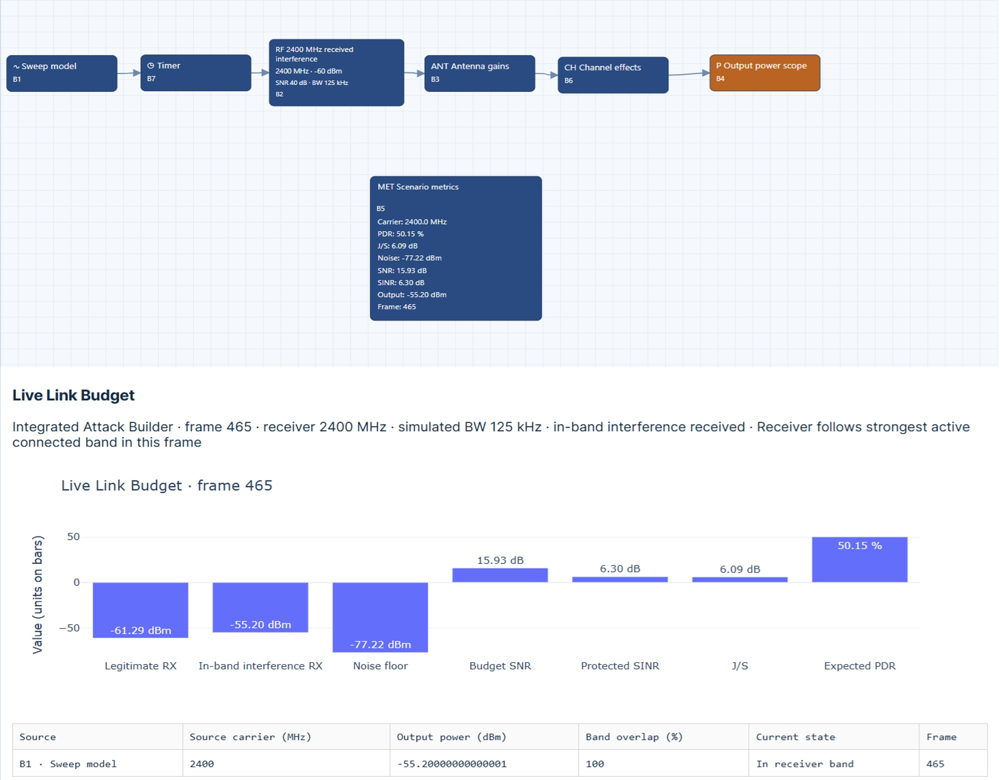

# Countermeasures, Mitigation Strategies, and Defensive Architectures
Hardware–Software Defensive Architectures: Implementation Requirements and Verification
A strong defensive architecture integrates preventive, detective, responsive, and recovery functions across the UAS. Useful tools include hardware-based key storage, secure software updates, interface controls, protected communications, anomaly detection, and managed recovery steps. Place these according to trust boundaries and the relationships between flight-critical and mission-support roles. When integrating these systems, consider how shared resources and failures can affect one another. For example, monitoring should not use up resources needed for flight control. Testing should assess each control on its own and in combination, especially during heavy use, failures, or poor communication. Make it clear who is responsible for setup, approval, maintenance, and incident response.

## Practical Example: Designing and Verifying a Selection Controller
Communication resilience requires an explicit defensive mechanism whose operation and limitations you can verify. Scenario names alone do not establish that switching or diversity is implemented. This exercise uses existing AeroResilience workflows as disturbance inputs to design and evaluate an additional channel-selection or path-selection controller.

### Practical Exercise 8.1: Channel or Path Selection Under Interference
**Objective:** Identify missing defensive functions, specify an additional selection controller, and compare the proposed architecture with the original configuration under equivalent disturbance conditions.

**Worked situation:** Load `D2D_Channel_Diversity_2400MHz.json` as a sweep-interference exposure scenario and use `D2D_Asymmetric_Links_2400MHz.json` to examine alternative link conditions. According to the supplied scenario description, the channel-diversity file contains a single RF path and does not explicitly implement channel switching. Inspect the loaded workflows to confirm their topology, available outputs, and configuration assumptions.

The solution therefore requires a separately designed and subsequently verified channel-selection or path-selection controller. Do not treat an output selector used to inspect a branch as an implemented communication handover mechanism without evidence of that behavior.
Supporting scenarios are provided through the book’s repository:
-UAV CyberPhysical Security repository
-Practical procedure.

Preserve both original JSON configurations and record the software revision, waveform settings, timing, and random seeds where applicable.
Trace the single RF path in the sweep-exposure scenario and the alternative link branches in the asymmetric-links scenario. Identify which defensive functions are absent. Choose whether the proposed architecture selects a frequency channel or a communication path. Define the candidates, required observations, control actions, and communication-state dependencies. Specify switching criteria, observation windows, persistence requirements, stale-measurement handling, and behavior when no candidate is usable. Implement the additional controller and any required candidate-link models or interfaces separately from the preserved baseline. Record all modifications and versions.
Compare baseline and controlled configurations under equivalent exposure conditions. Measure transition effects and preserve both improvement and failure cases. Illustrated baseline. The baseline image below provides the configuration view used to identify the disturbance inputs and missing defensive functions.

AeroResilience configuration view supporting selection-controller design. Existing sweep-interference and alternative-link workflows provide disturbance inputs; the single-path channel-diversity scenario does not implement a channel-switching defense.
Hint. A controller cannot establish the quality of an unobserved alternative from the current path’s performance alone. Identify how candidate-channel or candidate-path observations are obtained and what sensing, probing, or modeling assumptions they require. Selecting a displayed scope output differs from coordinating an actual change in the communication channel or route.
Worked solution: missing functions and architecture. Document the functions to add: candidate definition, quality observation, decision logic, coordinated switching, state confirmation, transition logging, and recovery or fallback behavior. Channel selection requires explicit representations of the candidate channels and their exposure conditions. Path selection requires evidence that each candidate supports the required communication service; an alternative anchor link is not automatically an interchangeable route for every mission function.
Connect the disturbance inputs to the candidate communication models, feed timestamped quality observations to the controller, and expose the controller’s selected candidate and state to an instrumented output. Verify transmitter–receiver coordination where relevant, or document the assumptions used to represent it in simulation. Preserve an unchanged baseline for comparison.
Worked solution: switching criteria. Define candidate eligibility using justified performance thresholds over a stated observation window. Reject stale or incomplete observations according to an explicit rule. Specify a switching margin and persistence interval to reduce oscillation between nearly equivalent candidates, and state the minimum dwell time where used.
A possible design retains the current candidate while it remains acceptable, and considers a switch when another eligible candidate offers a sufficient sustained improvement or the current candidate violates its criterion. These are proposed rules, not functions claimed for the supplied JSON files. If no candidate is eligible, report degraded availability and apply the mission-defined fallback rather than silently declaring a usable link.
Worked solution: transition costs. Account for observation or probing overhead, decision computation, coordination messages, retuning or route changes, synchronization, and any packet buffering or loss during the transition. State which costs are modeled and which require implementation measurements. For a defined transition, measure service interruption from the last valid pre-transition delivery to the first valid post-transition delivery, and report any normal delivery interval included in that measurement.
A controller that improves steady-state link quality may still reduce useful service if transitions are too frequent or costly. Retain switch counts, transition durations, modeled or measured lost or delayed packets, and failed coordination events. Do not infer hardware retuning time, energy consumption, or processing overhead from RF quality metrics alone.
The evaluation image below provides the observation view used to compare the original configuration with the additional selection architecture.

Observation view supporting baseline and selection-controller comparison. Evidence of improvement requires an implemented controller, equivalent disturbance conditions, and recorded transition effects; scope selection alone does not demonstrate channel or path switching.
Verification and equivalent-condition comparison. Define acceptance criteria before testing. Hold the disturbance schedule, legitimate traffic assumptions, observation duration, and shared RF parameters fixed where applicable. Reuse matched stochastic realizations when supported, or repeat trials and document variability. Identify additional candidate resources and sensing capabilities introduced by the proposed architecture so that their contribution is visible in the comparison.
Compare reported expected PDR, time satisfying the declared availability criterion, outage duration, recovery behavior, and transition effects where supported. Distinguish modeled indicators from measured packet delivery and implementation costs. Verify controller state transitions explicitly; improved output metrics alone do not prove correct switching behavior.
Include cases where an alternative is usable, all candidates are degraded, quality estimates are stale, and candidate quality alternates near the switching threshold. Evaluate failed or delayed coordination where the implementation supports it. Keep unsuccessful cases in the report and explain whether failure follows from exposure, missing observations, switching overhead, or controller behavior.
Implementation checklist:
- [ ] Identify missing defensive functions in the original workflows.
- [ ] Distinguish channel selection, path selection, and display-output selection.
- [ ] Define candidate eligibility, switching criteria, and fallback behavior.
- [ ] Document candidate observations, timing, and coordination assumptions.
- [ ] Record transition costs and the instrumentation used to obtain them.
- [ ] Compare the proposed and original configurations under equivalent conditions.
- [ ] Retain evidence of improvement, failed transitions, and non-usable candidate cases.
- [ ] Preserve baseline configurations, controller versions, and assessment records.

**Expected deliverable:** A documented selection-controller architecture, implemented and verified separately from the exposure workflows, with a baseline comparison reporting performance benefits, transition costs, failure cases, and remaining limitations. If implementation is incomplete, report the design and verification plan without claiming demonstrated improvement.

## Practical Example: RF Channel Modeling and Countermeasure Assessment
This exercise connects propagation models to the RF hardware assumptions used in a communication-resilience assessment. It distinguishes large-scale path loss, small-scale fading, multipath dispersion, receiver noise, and interference, then evaluates a specified countermeasure against a matched baseline.

### Practical Exercise 8.2: RF Channel, Interference, and Countermeasure Evaluation
**Objective:** Develop a traceable RF channel model including path loss, fading, multipath, antennas, SDR hardware, and power reference points, and evaluate whether an independently implemented countermeasure improves communication performance under defined interference conditions.
**Worked situation:** A UAV communication receiver experiences degraded packet delivery. Determine how much of the degradation can be explained by propagation and receiver conditions, how the result changes when controlled interference is added, and whether a selected countermeasure provides a repeatable improvement. Use AeroResilience for scenario organization where supported and an additional waveform-level channel implementation where necessary. Do not assume that an existing scenario explicitly models every propagation effect or implements the proposed countermeasure.
**RF system and reference planes:** Document the desired transmitter, interference source, receive chain, antennas, cables, filters, connectors, and any amplifiers or attenuators. For the SDR, record frequency coverage, usable instantaneous bandwidth, sample rate, gain settings, duplex mode, timing arrangement, and the calibration method used to relate digital amplitude to RF power. Select hardware against these requirements rather than assuming that every SDR supports the intended channel.
Define reference planes at the transmitter output and receiver input. Record average and peak power where relevant, occupied bandwidth, antenna orientation and polarization, and receiver gain-control behavior. A software gain setting is not itself a calibrated output power in dBm. For initial hardware comparison, use a characterized conducted or shielded arrangement with suitable attenuation, combining, and power measurement, observing the equipment’s specified input limits.
Practical procedure.

Define the waveform, carrier frequency, bandwidth, packet structure, observation interval, and communication acceptance criteria.
Establish a baseline with receiver noise and large-scale path loss. State antenna gains, cable losses, and power reference planes.
Introduce a documented multipath profile and fading process. Preserve channel realizations or seeds for matched comparisons.
Add a controlled interference condition with its own source-to-receiver channel. Record actual exposure timing and in-band received interference power. Implement a specified countermeasure, such as a narrowband rejection filter with documented parameters, and compare enabled and disabled cases using the same inputs. Include interference-free, fading-only, interference-only, and combined cases. Record packet outcomes, signal-quality indicators, countermeasure costs, and failure cases. Where hardware is available, repeat a defined subset using calibrated RF measurements and document differences between the model and implementation.

>Hint: Propagation affects the desired and interfering signals through different paths. Keep their channel models separate. A filter can suppress interference while also distorting desired signal components; an improvement in a plotted spectrum does not alone establish improved packet delivery.

**Worked solution:** path loss and antenna terms. For a far-field free-space reference, define

$$
L_{\mathrm{FS}}(d)
=20\log_{10}!\left(\frac{4\pi d}{\lambda}\right),
\qquad \lambda=\frac{c}{f_c}.
$$

State that this is a reference model rather than a universal description of obstructed or near-field propagation. A calibrated log-distance alternative is

$$
L_{\mathrm{PL}}(d)
=L_0+10n\log_{10}(d/d_0)+X_{\sigma},
$$

where $L_0$ is the reference loss at distance $d_0$, $n$ is the path-loss exponent, and $X_{\sigma}$ represents shadowing in dB. Specify the valid distance range, parameter source, and spatial or temporal correlation used for shadowing.
For the desired signal, use a consistent link budget:

$$
S_{\mathrm{RX}}
=P_{\mathrm{TX}}+G_{\mathrm{TX}}+G_{\mathrm{RX}}
-L_{\mathrm{PL}}-L_{\mathrm{other}},
$$

with powers in dBm and gains and losses in dB. Include cable, polarization, and other losses in $L_{\mathrm{other}}$ without double counting losses already represented elsewhere. Specify realized antenna gains in the relevant directions and frequency range. Establish an analogous budget for the interference path. In a conducted setup, replace radiated antenna and propagation terms with the measured transfer losses of the test network.

**Worked solution:** Fading and multipath. At waveform level, represent the received complex baseband signal by

$$
y[k]=\sum_{\ell=0}^{L_s-1}h_{s,\ell}[k]x[k-d_{s,\ell}]
+\sum_{m=0}^{L_j-1}h_{j,m}[k]j[k-d_{j,m}]
+w[k].
$$

Here $x[k]$ and $j[k]$ are the desired and interference waveforms, $h_{s,\ell}[k]$ and $h_{j,m}[k]$ are their channel taps, the $d$ terms are discrete delays, and $w[k]$ is receiver noise. Document how you handle fractional delays, if needed. Define the power-delay profile, fading distribution, time correlation or Doppler assumptions, and any line-of-sight component. Normalize small-scale channel power before applying large-scale attenuation, or state explicitly how you incorporate both into the taps. Do not apply a separate fading multiplier when the same fading effect is already represented by time-varying multipath taps. Fixed taps represent a static multipath response; time-varying fading requires additional dynamics. GNU Radio provides channel-model building blocks, but you must check the supported impairments and parameter meanings for the selected block and version.

**Worked solution:** Noise and interference ratios. Define noise power over a stated receiver bandwidth. Where a thermal-noise model is appropriate,

$$
N_{\mathrm{dBm}}
=10\log_{10}!\left(\frac{k_{\mathrm{B}}TB}{10^{-3},\mathrm{W}}\right)
+F_{\mathrm{dB}},
$$

where $T$ is the assumed input noise temperature, $B$ is the equivalent noise bandwidth, and $F_{\mathrm{dB}}$ is receiver noise figure under the stated reference conditions. Use an externally specified noise floor instead if its bandwidth and reference plane are documented; do not add the same receiver noise contribution twice.
For powers evaluated at the same receiver reference point with compatible integration bandwidths,

$$
\mathrm{SNR}{\mathrm{dB}}=S{\mathrm{RX}}-N,
\qquad (J/S){\mathrm{dB}}=J{\mathrm{RX}}-S_{\mathrm{RX}},
$$

$$
\mathrm{SINR}{\mathrm{dB}}
=10\log{10}!\left(\frac{P_S}{P_J+P_N}\right),
$$

where the $P$ quantities are linear powers. Do not add dBm values directly. Account for interference spectral overlap and any receiver filtering. If correlated signal components or distortion affect the power decomposition, document the estimator and its limitations rather than assuming independent additive powers.

**Worked solution:** countermeasure and comparison. Specify the countermeasure’s actual implementation, activation rule, parameters, and observation point. For a narrowband rejection filter, record its frequency response and how it affects both the desired waveform and the interference. Keep a bypass baseline and freeze any tuned parameters before scoring held-out evaluation trials.
Compare valid packet delivery, outage intervals, recovery behavior, and signal-quality estimates under matched channel and interference realizations. Include an interference-free enabled case to reveal countermeasure-induced degradation. Report expected model PDR separately from measured packet counts. If the countermeasure changes bandwidth, coding, or useful data rate, report those changes so that an apparent improvement is not interpreted without its cost. Measure or explicitly model added processing delay, transient losses, and computational load. Hardware power and energy require calibrated instrumentation; receiver signal power in dBm does not equal device electrical power consumption. Retain cases where the countermeasure fails, becomes unstable, or damages desired-signal reception. A receiver operating in compression or clipping requires a nonlinear front-end model or direct measurement beyond linear-channel simulation.
Assessment record. For each test case, retain the waveform and traffic configuration, channel parameters and seeds, antenna or conducted-network terms, desired/interference/noise powers with bandwidths and reference planes, SDR configuration, countermeasure version, acceptance thresholds, packet outcomes, implementation costs, and evidence references. Identify which entries are configured, simulated, calibrated, or measured.
Implementation checklist:
- [ ] Define RF reference planes, bandwidths, and average/peak power conventions.
- [ ] Document path-loss assumptions and antenna gains, polarization, and cable losses.
- [ ] Model desired and interference propagation separately.
- [ ] Specify multipath delays, tap normalization, fading statistics, and time variation.
- [ ] Verify SDR capabilities, gain settings, calibration, and receiver linearity.
- [ ] Identify the implemented countermeasure and its effects on the useful signal.
- [ ] Compare equivalent trials and retain improvement and failure cases.
- [ ] Distinguish RF signal power, processing overhead, and electrical energy consumption.

**Expected deliverable:** A reproducible RF channel and hardware-reference model, a matched baseline/countermeasure comparison, and an evidence-backed report explaining performance gains, costs, failure conditions, and model limitations.
Implementation references. Consult the documentation matching the installed software and hardware versions:
* GNU Radio channel models: https://wiki.gnuradio.org/index.php/Channel_Model and https://wiki.gnuradio.org/index.php/Dynamic_Channel_Model.
* Ettus UHD power-level controls: https://files.ettus.com/manual/page_power.html.
