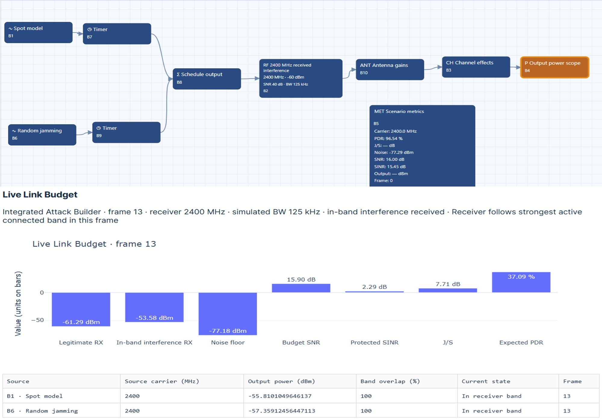
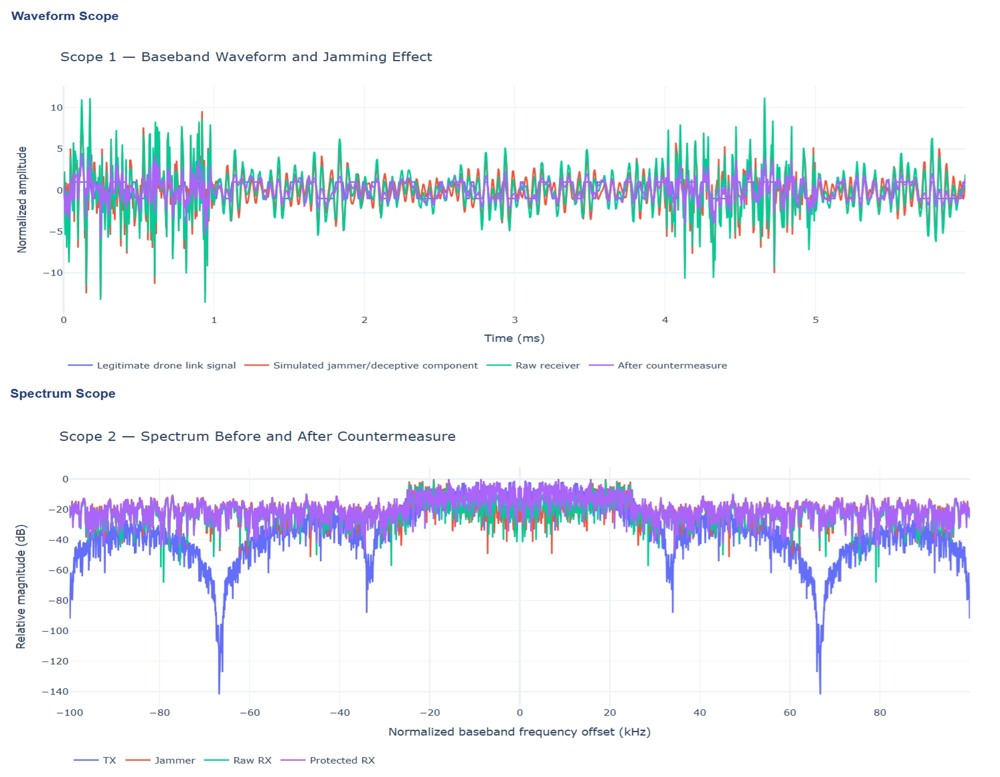

# UAS Weaponization Risks and Counter-UAS Security Implications
A counter-UAS security system can use RF sensing, radar, optical or thermal sensors, track processing, identification tools, and operator interfaces. The system needs to show the evidence behind each assessment, including uncertainty, sensor disagreements, and track history.
Keep detection, identification, authorization checks, and response decisions separate. Hardware and software requirements depend on sensor coverage, data rates, processing speed, and the number of tracks monitored simultaneously. To ensure accountability, record when alerts are generated, how operators interpret them, who makes decisions, and any approved responses. Manage evidence so it can be reviewed later under applicable information governance rules.

## Practical Example: RF Observations, Authorization, and Evidence Fusion
RF monitoring can characterize a communication disturbance without establishing its source, an aircraft's authorization status, or hostile intent. This exercise uses contrasting simulated exposure patterns to distinguish disturbance detection from identification, attribution, and operational decision-making. The evidence-fusion proposal identifies the records, tracking observations, and human review needed to support a bounded decision.

### Practical Exercise 10.1: From RF Disturbance Observations to Reviewed Decisions
**Objective:** Compare continuous, intermittent, and random RF disturbance patterns and develop an evidence-fusion proposal that preserves uncertainty and separates observation from authorization and response decisions.
**Worked Situation**  Load these scenarios:
- `Friendly_Spot_Continuous_2400MHz.json`
- `Friendly_Spot_Intermittent_2400MHz.json`
- `Friendly_Spot_Random_2400MHz.json`
  
Inspect the configured activation rules and available outputs before comparing their temporal patterns. These workflows represent RF conditions, not a complete counter-UAS system. The word “Friendly” in a filename is a scenario label, not evidence that an observed aircraft or RF source is authorized. The book's UAV CyberPhysical Security repository provides supporting scenarios.

**Practical Procedure**
Preserve the three configurations and record the simulator revision, observation interval, model settings, and random seeds where applicable.
Verify scheduled exposure windows and actual modeled interference activity. Compare equivalent observation windows and document differences in non-timing parameters. Record available power, waveform, spectrum, and link-performance outputs. Describe continuity, duration, recurrence, and variability without assigning aircraft identity or intent. State which conclusions are directly supported, which are hypotheses, and which require additional evidence. Identify the authorization records, independent tracking observations, identity-related information, and operator review required to resolve outstanding questions. Propose a fusion and review process that records evidence provenance, uncertainty, conflicting observations, and decision authority before any response decision.
Illustrated RF Comparison
The following figure presents the three simulated temporal patterns using comparable observation windows.

Proposed comparison of simulated continuous, intermittent, and random spot-interference observations. Differences characterize modeled RF exposure; they do not establish aircraft identity, authorization status, or hostile intent.

> Hint: Keep the monitored RF disturbance, its possible emitter, and any tracked aircraft as separate entities until evidence supports their association. A nearby aircraft and a simultaneous RF anomaly may be unrelated. Missing identification or authorization information is an unresolved evidence gap, not automatic proof of hostility.

**Worked Solution:** Characterize the Disturbance
Prepare one observation record for each scenario. State the configured temporal behavior and compare it with actual model activity and reported outputs.

**Retain:** 
* The observation point.
* Frequency and bandwidth, where available.
* Interval boundaries and selected output.
* Evidence references.

If expected PDR is displayed, identify it as a simulation output rather than a measured operational result.
The three records can support statements about persistence, intermittency, or variability under the stated model assumptions. They cannot establish whether a real aircraft is authorized, identify the emitter, or determine intent.
Similar RF symptoms may have multiple causes. The scenario configuration supplies simulation ground truth that an operational observer would not necessarily possess.

**Worked Solution evidence-Fusion proposal:** Develop a case record with the following separately maintained evidence categories.
Evidence category	Records and verification requirements. Authorization records	Relevant mission approvals, expected flight schedules, operating permissions or local authorization records, and verified contact information for the responsible operator. Record geographic and temporal scope and how currency was checked. Tracking observations	Independently obtained position, motion, time, and track-continuity information from available sensors. Record coverage, uncertainty, association method, and gaps. Identity-related information	Available identification transmissions, cooperative reports, registration information, or operator confirmation. Document verification status; an unverified identifier is not conclusive evidence of identity. RF observations	Disturbance characteristics, measurement or simulation context, timestamps, uncertainty, and evidence supporting association with a particular emitter or track. Operator review	The reviewer's assessment of corroboration, contradictions, missing information, and the rationale for further observation or escalation.
Align observations using documented time and spatial references. Associate records only when accuracy, timing, and corroboration support the link. Preserve competing associations when uncertainty remains. Do not count repeated copies of one underlying source as independent corroboration. Report unresolved identity, authorization, and source-association questions separately rather than combining them into an unsupported hostile/not-hostile label. The following figure illustrates the proposed fusion process and its human review boundary.

Proposed evidence-fusion and review architecture connecting RF observations, authorization records, tracking information, and identity-related evidence. Retain uncertainty and provenance before an identified decision authority reviews the case.
Operational Decision-Making. Separate the monitoring output, attribution assessment, authorization assessment, and response decision in the case record. Identify the responsible decision authority and applicable organizational procedures and permissions. Define when additional observation, operator contact, or escalation is required.

This exercise proposes an evidence and review process. It does not establish permission to interfere with an aircraft or demonstrate a complete response capability.
For each reviewed case, record:
* Evidence available at the decision time.
* Remaining uncertainty.
* Chosen action or decision to defer.
* Responsible person.
* Review timestamp.

A later correction must preserve the earlier record and explain what new evidence changed the assessment.
Implementation Checklist
- [ ] Record uncertainty, observation limits, and alternative explanations.
- [ ] Separate RF disturbance detection from source attribution and aircraft identification.
- [ ] Verify authorization against current records with a defined scope.
- [ ] Document how RF observations are associated with a tracked aircraft, if at all.
- [ ] Identify the decision authority and required operator review.
- [ ] Preserve supporting observations, provenance, timestamps, and contradictory evidence.
- [ ] State that the workflows model RF conditions rather than a complete counter-UAS system.

**Expected Deliverable:** A comparison of the three RF output patterns and an evidence-fusion proposal identifying the additional authorization records, tracking observations, identity checks, and operator review needed before a response decision.
The report must state which conclusions are supported and which remain unresolved.
